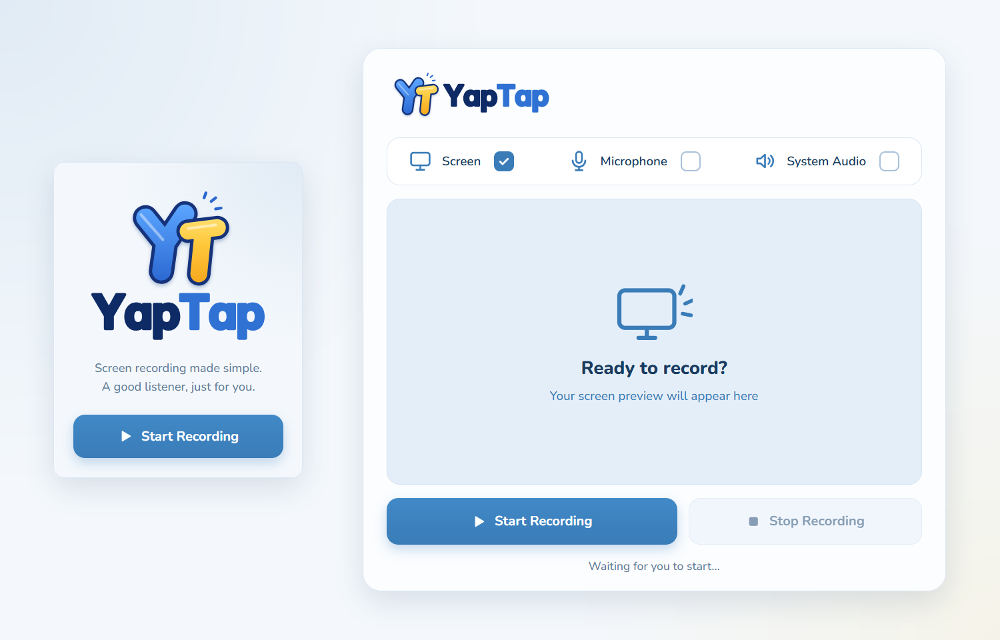
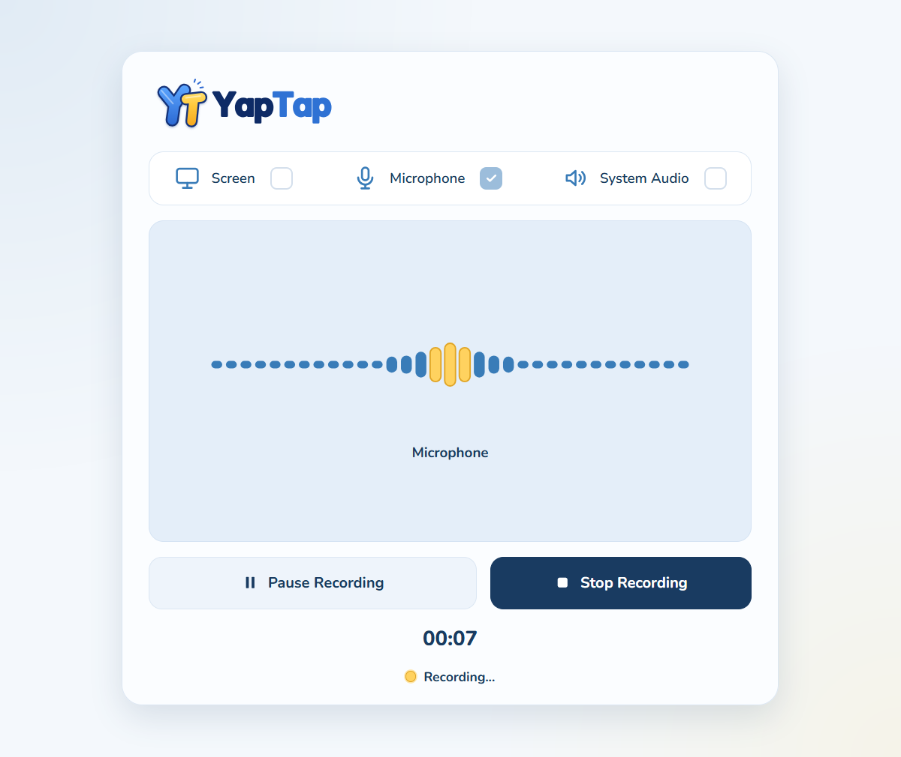

# YapTap

Screen recording made simple. A good listener, just for you.

YapTap is a Chrome extension (Manifest V3) that records your screen, your microphone, your system audio, or any mix of them, and saves the result straight to your downloads folder. There are no accounts, no servers and no uploads. Everything happens in your browser.



## Features

- Record your screen, your microphone, your system audio, or any combination
- Mixes microphone and system audio into a single track
- 3-2-1 countdown before recording starts, with a Cancel button
- Pause and resume, with a timer that stays accurate across pauses
- Live preview of your screen, or a sound-reactive visualizer when you record audio only
- Long recordings are written to disk while you record instead of piling up in memory
- One-click stop, with automatic download of the finished file
- Recording stops on its own if you end screen sharing from Chrome's own bar
- Nothing leaves your machine

## Install (development)

1. Clone or download this repository.
2. Open `chrome://extensions` in Chrome.
3. Turn on **Developer mode** (top right).
4. Click **Load unpacked** and select the `extension` folder (the one that contains `manifest.json`).
5. Pin YapTap from the puzzle-piece menu so it's always in your toolbar.

After you edit any file, click the reload icon on the YapTap card in `chrome://extensions`, then reopen the popup or recording tab.

## How to use

1. Click the YapTap icon in the toolbar, then **Start Recording**. This opens the recording page in a new tab.
2. Choose what to record: **Screen**, **Microphone**, **System Audio**, or any combination. At least one must be selected.
3. Click **Start Recording**. Chrome asks what to share (and for microphone access if you selected it).
4. Wait for the countdown. Click **Cancel** on it if you change your mind.
5. Use **Pause Recording** and **Resume Recording** as often as you like.
6. Click **Stop Recording** when you're done. The file downloads automatically as `yaptap-recording-<timestamp>.webm`.



### Recording system audio

System audio comes from Chrome's share dialog, so there are a few things to know:

- In the dialog, choose a **tab** or the **entire screen**, and tick **Share audio** (or **Share tab audio**). If you don't, YapTap shows a message and nothing is recorded.
- Sharing a single **window** doesn't include audio.
- Support depends on your system and Chrome version. Tab audio works on every platform. Full system audio is available on Windows and ChromeOS when you share the entire screen. On macOS it is usually limited to tab audio.
- If you record the microphone and system audio together, use headphones. Otherwise the microphone picks up your speakers and you hear an echo.
- With **System Audio** selected and **Screen** unselected, you still pick a tab or screen in Chrome's dialog. Chrome requires that. Only the audio is recorded.

### Good to know

- Screen recordings capture video at up to 1920×1080 and 30 fps, so recording a 4K screen stays light on your CPU.
- Audio-only recordings are saved as audio in a `.webm` file.
- Video is encoded as VP9 + Opus when the browser supports it, then VP8 + Opus, otherwise as standard WebM.
- While you record, the data is written to a temporary file in the extension's private storage on your disk. It is deleted when you start the next recording, and leftovers older than 6 hours are cleaned up when the recording page opens. If the browser doesn't support this, YapTap falls back to memory.
- The recording page has to stay open while you record. Closing the tab ends the recording, and the part that wasn't saved yet is lost. Don't open two recording tabs at the same time.
- `.webm` files from the browser's recorder don't contain duration information, so some players can't seek in them. You can fix this without re-encoding: `ffmpeg -i input.webm -c copy output.webm`.

## Project structure

```
extension/
├── manifest.json          Extension config, icons, popup and service worker
├── background/
│   └── background.js      Opens the recording page when the popup asks for it
├── popup/                 The small window opened from the toolbar icon
│   ├── popup.html
│   ├── popup.css
│   └── popup.js
├── recording/             The full-page recorder
│   ├── recording.html
│   ├── recording.css
│   └── recording.js       Capture, countdown, preview, recording, disk storage and saving
├── shared/
│   └── theme.css          Palette, font, reset and shared button styles
├── fonts/
│   └── Nunito.woff2       Bundled font
├── icons/                 Extension icons (16, 32, 48, 128 px)
└── images/                Logo files (SVG + PNG): full, stacked and mark only
docs/
└── preview.png            Screenshot used in this README
```

## How it works

- `popup.js` sends an `open-recording-page` message. `background.js` receives it and opens `recording/recording.html` in a new tab.
- `recording.js` captures with `navigator.mediaDevices.getDisplayMedia()` for the screen and system audio, and `getUserMedia()` for the microphone.
- If there is more than one audio source, they are mixed with the Web Audio API (`AudioContext`) into one track, because `MediaRecorder` only records a single audio track. The same audio graph feeds an `AnalyserNode` that drives the visualizer in audio-only mode.
- The countdown runs after the share dialog closes, so the dialog never ends up in your recording.
- `MediaRecorder` delivers a chunk every second. Each chunk is appended to a temporary file in the Origin Private File System, which lives on your disk. When you stop, the file is handed to the browser as a download, read from disk and not loaded into memory.
- The timer uses `performance.now()` and subtracts paused time, so it doesn't drift.
- The extension requests no special permissions in `manifest.json`.

### Performance settings

At the top of `recording/recording.js`:

| Constant | Default | What it does |
| --- | --- | --- |
| `COUNTDOWN_SECONDS` | `3` | Length of the countdown |
| `VIDEO_BITRATE` | `2_500_000` | Video bitrate in bits per second |
| `AUDIO_BITRATE` | `128_000` | Audio bitrate in bits per second |
| `CHUNK_MS` | `1000` | How often data is flushed to disk |
| `MAX_WIDTH` / `MAX_HEIGHT` | `1920` / `1080` | Maximum capture size |

If your computer gets hot or laggy while recording, move the `vp8` line above `vp9` in `getRecorderOptions()`. VP8 is lighter on the CPU, at the cost of larger files.

## Design and theming

The look comes from `shared/theme.css`. Change a variable there and both pages update.

| Variable | Colour | Role |
| --- | --- | --- |
| `--yt-blue` | `#397CB8` | Primary buttons, icons, checkboxes, visualizer bars |
| `--yt-bg` | `#F4F8FC` | Page background |
| `--yt-navy` | `#193B61` | Text, Stop button while recording, countdown overlay |
| `--yt-yellow` | `#FFD25F` | Accent, the live recording dot, center of the visualizer |

**Font:** the design uses Nunito, a rounded sans-serif. It is bundled at `extension/fonts/Nunito.woff2` and loaded by the `@font-face` block in `shared/theme.css`. If the file is missing, the UI falls back to your system font.

**Recording state:** `recording.js` sets `document.body.dataset.state` to one of the values below. The CSS uses it to show the pulsing yellow dot, the navy Stop button and the timer colour, so you can style new states without touching the logic.

| State | When |
| --- | --- |
| `idle` | Nothing is happening |
| `countdown` | The 3-2-1 countdown is running |
| `recording` | Recording is in progress |
| `paused` | Recording is paused |
| `processing` | The file is being finalised and saved |

## Roadmap ideas

- Seekable WebM files (write the duration into the file)
- MP4 export